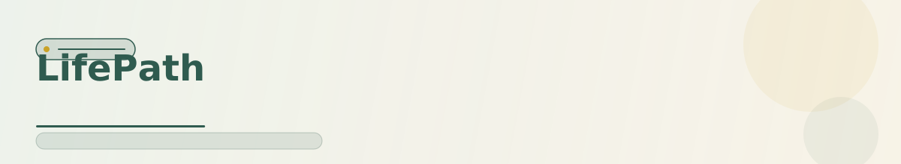
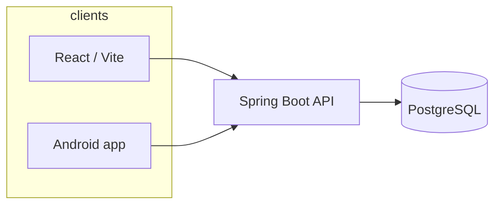

<div align="center">

<picture>
  <source media="(prefers-color-scheme: dark)" srcset="docs/readme/header-dark.svg">
  
</picture>

[](https://openjdk.org/)
[](https://spring.io/projects/spring-boot)
[](https://react.dev/)
[](LICENSE)
[](DOCKER.md)

<picture>
  <source media="(prefers-color-scheme: dark)" srcset="docs/readme/divider-dark.svg">
  
</picture>

</div>

## Why it exists

Most todo apps feel like spreadsheets with notifications. **LifePath** treats progress as a game: complete quests, keep streaks, and watch a **city/garden** reflect how you show up day to day. One backend, a polished web client, and an Android app share the same OpenAPI contract — so your habits follow you across devices.

## Highlights

- 🏙️ **City / garden view** — the world changes when you show up
- ⚔️ **Quests & habits** — streaks and reward loops that stay motivating
- 📱 **OpenAPI contract** — web, API, and Android share `openapi/lifepath-api.yaml`

## Features

| | |
|---|---|
| **Quests & habits** | Structured goals with streaks and reward loops that stay motivating |
| **City / garden view** | Visual progress — the world changes when you do |
| **Spring Boot API** | Java 21, PostgreSQL, Flyway migrations, versioned REST |
| **React web app** | TypeScript, Vite, dev proxy to the API |
| **Android** | Kotlin client with widgets and notifications |
| **OpenAPI contract** | `openapi/lifepath-api.yaml` — single source of truth for clients |

## Architecture



| Layer | Technology |
|-------|------------|
| API | Java 21, Spring Boot, PostgreSQL, Flyway |
| Web | React 18, TypeScript, Vite |
| Mobile | Kotlin, Android (widgets & notifications) |
| Contract | OpenAPI (`openapi/lifepath-api.yaml`) |

## Quick start

**Fastest path — full stack in Docker:**

```bash
git clone https://github.com/Vector26/LifePath.git
cd LifePath
cp .env.example .env
docker compose up -d
```

| Service | URL |
|---------|-----|
| Web UI | http://localhost:39173 |
| REST API | http://localhost:39081/api/v1 |

See [DOCKER.md](./DOCKER.md) for rebuild, logs, and environment variables.

### Development

**Prerequisites:** Docker & Compose, JDK 21, Maven, Node.js 20+

```bash
# Backend
cd backend && ./mvnw spring-boot:run

# Web (port 39173, proxies /api → 39081)
cd web && npm install && npm run dev

# Tests
cd backend && ./mvnw test
cd web && npm run test
```

**Android:** Open `android/` in Android Studio. Copy `android/local.properties.example` → `local.properties` and point the app at your reachable backend (`APP_FRONTEND_URL`).

### Configuration

**Do not commit `.env`.** Copy [.env.example](./.env.example):

| Variable | Purpose |
|----------|---------|
| `POSTGRES_PASSWORD` | Database password for Docker Compose |
| `APP_FRONTEND_URL` | Browser/mobile URL (OAuth and deep links) |
| `GOOGLE_REDIRECT_URI` | Google Calendar OAuth callback |

Google Calendar requires OAuth client credentials in the backend — see `docs/backend/AUTHENTICATION.md`.

> **What makes it different**
>
> LifePath is not a generic CRUD task list. Progress is **visible and emotional** (city/garden), while the stack stays **production-shaped**: typed API, migrations, tests, and a real mobile client — portfolio-grade full-stack, not a weekend demo.

## Status

| Area | State |
|------|--------|
| Docker stack | Stable for local full-stack runs |
| Web + API | Active development |
| Android | Widgets & notifications (see `docs/android/`) |
| Google Calendar | OAuth documented; credentials are yours to configure |

## Documentation

- [DOCKER.md](./DOCKER.md) — container deployment
- [docs/web/ARCHITECTURE.md](./docs/web/ARCHITECTURE.md) — frontend structure
- [docs/backend/API_SPECIFICATION.md](./docs/backend/API_SPECIFICATION.md) — API overview
- [openapi/lifepath-api.yaml](./openapi/lifepath-api.yaml) — OpenAPI schema

---

[Vector26](https://github.com/Vector26) · [MIT License](LICENSE)
