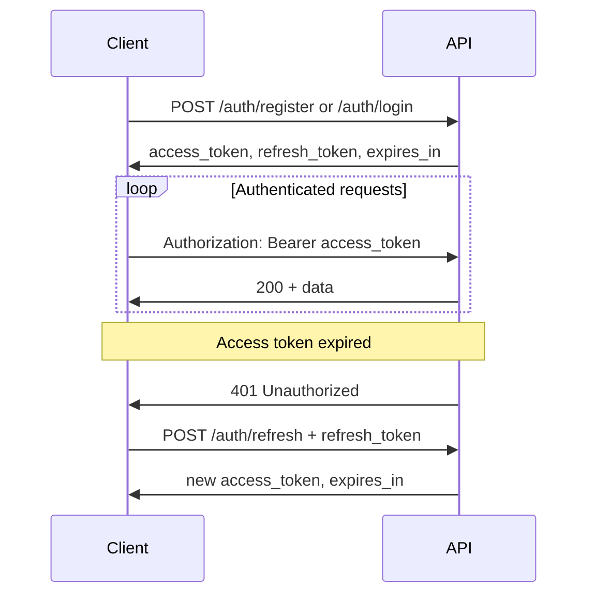

# LifePath Authentication

Authentication design for the LifePath API. Tech-agnostic; implement with JWT, sessions, or other secure mechanisms.

---

## Overview

- **Auth model**: Access token + refresh token
- **Storage**: Access token in memory or secure storage; refresh token in secure storage
- **Privacy**: No AI; no third-party identity providers required (optional OAuth later)

---

## Auth Flow



---

## Token Types

### Access Token

- **Purpose**: Authorize API requests
- **Lifetime**: 15 minutes (900 seconds) recommended
- **Storage**: Memory preferred; avoid persistent storage if possible
- **Format**: JWT or opaque string; server validates on each request
- **Claims** (if JWT): `sub` (user_id), `exp`, `iat`, optional `device_id`

### Refresh Token

- **Purpose**: Obtain new access token without re-entering credentials
- **Lifetime**: 7–30 days (configurable)
- **Storage**: Secure storage only (Keychain, Android Keystore, httpOnly cookie)
- **Single use**: Consumed on refresh; new refresh token may be issued (rotating refresh)
- **Binding**: Optional device/session ID to detect theft

---

## Endpoints Summary

| Endpoint | Auth Required | Purpose |
|----------|---------------|---------|
| POST /auth/register | No | Create account |
| POST /auth/login | No | Obtain tokens |
| POST /auth/refresh | No (uses refresh_token in body) | New access token |
| POST /auth/logout | Yes | Revoke refresh token |

---

## Header Usage

**Request:**

```
Authorization: Bearer <access_token>
```

**Missing or invalid token** → 401 Unauthorized

```json
{
  "error": {
    "code": "UNAUTHORIZED",
    "message": "Invalid or expired access token"
  }
}
```

---

## Refresh Flow

1. Client receives 401 on any request.
2. Client calls `POST /auth/refresh` with `refresh_token`.
3. If valid: API returns new `access_token` and optionally new `refresh_token`.
4. If invalid (expired, revoked, reused): 401 → client must re-login.

**Idempotency**: Refresh can be retried if network fails; use short-lived idempotency window to avoid token reuse errors.

---

## Device / Session Management

- Each login can create a new session.
- Store `device_id` or `session_id` with refresh token for auditing.
- Logout revokes the refresh token for current session.
- Optional: `GET /auth/sessions` to list active sessions; `DELETE /auth/sessions/:id` to revoke.

---

## Security Considerations

| Topic | Recommendation |
|-------|----------------|
| Password storage | Bcrypt (cost 12+) or Argon2id |
| HTTPS | Required for all auth endpoints |
| Token transmission | Never in URL; body or header only |
| CSRF | Not needed for token-based API; ensure no cookie auth for SPA |
| Rate limiting | 10 req/min per IP for login/register |
| Brute force | Rate limit + optional account lockout after N failures |

---

## Local-First / Offline

- Access token allows offline use only if client caches data and does not require real-time validation.
- On reconnect: refresh token to get new access token before syncing.
- Do not store passwords locally; only tokens in secure storage.

---

## Privacy

- No AI processing of auth data.
- No third-party analytics on auth endpoints.
- Tokens contain minimal claims (user_id, exp); no PII in token payload.
- Comply with GDPR/CCPA for user data export and deletion.
