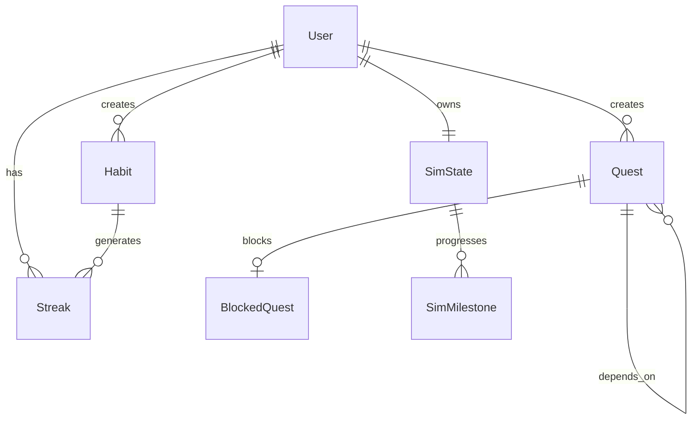

# LifePath Backend Data Models

This document defines the core data entities and their relationships for the LifePath gamified productivity application.

---

## Entity Overview

---

## User

| Field | Type | Required | Description |
|-------|------|----------|-------------|
| id | UUID | Yes | Primary key |
| email | string | Yes | Unique, used for login |
| password_hash | string | Yes | Bcrypt/Argon2 hash, never exposed |
| display_name | string | No | Optional user-facing name |
| timezone | string | Yes | IANA timezone (e.g., `America/New_York`) for streak/day boundaries |
| total_xp | int | Yes | Lifetime XP from quest complete/block (default 0). See [GAMIFICATION_ENGINE.md](GAMIFICATION_ENGINE.md) |
| created_at | timestamp | Yes | Account creation |
| updated_at | timestamp | Yes | Last profile update |

**Derived:** `level = floor(total_xp / 100)`. Optionally cached in `level` column.

---

## Quest

A task (quest) with optional dependencies. Only leaf nodes (no incomplete dependencies) are eligible for the current objective.

| Field | Type | Required | Description |
|-------|------|----------|-------------|
| id | UUID | Yes | Primary key |
| user_id | UUID | Yes | Foreign key to User |
| title | string | Yes | 1-500 chars |
| notes | string | No | Free-form notes, max 5000 chars |
| priority_level | enum | Yes | P0, P1, P2, P3, P4 (see Priority Algorithm) |
| parent_id | UUID | No | Foreign key to Quest; null = root |
| status | enum | Yes | `pending`, `blocked`, `completed` |
| time_of_day | enum | No | `morning`, `afternoon`, `evening`, `any` |
| context_tag | enum | No | `focus`, `quick`, `low_energy` |
| created_at | timestamp | Yes | |
| updated_at | timestamp | Yes | Last modification |
| completed_at | timestamp | No | Set when status = completed |
| deleted_at | timestamp | No | Soft delete; exclude from algorithm and lists when set |

**Priority levels:**
- P0: Critical / deadline today
- P1: High / this week
- P2: Normal / no deadline
- P3: Low / whenever
- P4: Backlog / someday

---

## BlockedQuest

Captures state when a quest is pushed to "IO-Wait" (waiting on external dependency). See [IO_MULTIPLEXING_LOGIC.md](IO_MULTIPLEXING_LOGIC.md) for state transitions and trigger semantics.

| Field | Type | Required | Description |
|-------|------|----------|-------------|
| id | UUID | Yes | Primary key |
| quest_id | UUID | Yes | Foreign key to Quest |
| reason | string | No | User note (e.g., "Waiting on vendor quote") |
| unblock_trigger | enum | Yes | `manual`, `time`, `location` |
| unblock_at | timestamp | No | For `time` trigger |
| unblock_location | string | No | For `location` trigger |
| created_at | timestamp | Yes | When blocked |
| unblocked_at | timestamp | No | When unblocked (null = still blocked) |

**Constraints:** Unique active block per quest: `UNIQUE(quest_id) WHERE unblocked_at IS NULL`.

---

## Habit

Recurring action that earns currency for the Sim and contributes to streaks.

| Field | Type | Required | Description |
|-------|------|----------|-------------|
| id | UUID | Yes | Primary key |
| user_id | UUID | Yes | Foreign key to User |
| title | string | Yes | 1-200 chars |
| currency_per_completion | int | Yes | Coins earned per completion (default 10) |
| is_streak_tracked | boolean | Yes | If true, contributes to streak |
| created_at | timestamp | Yes | |
| updated_at | timestamp | Yes | |
| deleted_at | timestamp | No | Soft delete; exclude from lists when set |

---

## HabitCompletion

Records each completion of a habit (for streaks and currency).

| Field | Type | Required | Description |
|-------|------|----------|-------------|
| id | UUID | Yes | Primary key |
| habit_id | UUID | Yes | Foreign key to Habit |
| completed_at | timestamp | Yes | Date + time (used for day boundary in user timezone) |

---

## Streak

Derived or cached streak data per habit per user.

| Field | Type | Required | Description |
|-------|------|----------|-------------|
| habit_id | UUID | Yes | Foreign key to Habit |
| user_id | UUID | Yes | Foreign key to User |
| current_streak_days | int | Yes | Consecutive days with completion |
| longest_streak_days | int | Yes | All-time best |
| last_completed_date | date | No | Last date (in user timezone) with completion |

---

## SimState

The user's Sims-style companion life progress.

| Field | Type | Required | Description |
|-------|------|----------|-------------|
| user_id | UUID | Yes | Primary key (1:1 with User) |
| total_currency | int | Yes | Lifetime coins earned (never decreases) |
| current_stage | enum | Yes | `starter`, `stable`, `thriving`, `flourishing` |
| companion_type | enum | Yes | User choice at setup (e.g., `plant`, `creature`) |
| created_at | timestamp | Yes | |
| updated_at | timestamp | Yes | |

**Life stages (additive, never regress):**
- starter: 0–199 coins
- stable: 200–499
- thriving: 500–999
- flourishing: 1000+

---

## SimMilestone

Predefined milestones the user can unlock. Progression is additive only.

| Field | Type | Required | Description |
|-------|------|----------|-------------|
| id | UUID | Yes | Primary key |
| stage | enum | Yes | Stage this milestone belongs to |
| currency_threshold | int | Yes | Coins required to unlock |
| title | string | Yes | Display name |
| description | string | No | Optional narrative |

---

## Priority Algorithm Inputs/Outputs

Full specification in [PRIORITY_ALGORITHM.md](PRIORITY_ALGORITHM.md).

### Inputs (from Quest + context)

| Input | Source | Description |
|-------|--------|-------------|
| priority_level | Quest | P0–P4 |
| parent_id | Quest | Dependency; null if root |
| status | Quest | Must be `pending` for eligibility |
| created_at | Quest | Recency bonus |
| updated_at | Quest | Staleness penalty |
| time_of_day | Quest | Time affinity |
| context_tag | Quest | User context match |
| blocked_since | BlockedQuest | Blocked-time bonus when unblocked |
| streak_habit_id | Habit (optional) | Streak alignment bonus |

### Output

- `current_quest`: Single Quest with highest computed score among eligible (non-blocked, dependency-satisfied) quests.
- `priority_score`: Internal numeric score for tie-breaking; not exposed to clients.
- `reasons`: Optional array for "Why this quest?" UI.

---

## Sync / Offline Metadata (Optional)

For offline-first clients:

| Field | Type | Description |
|-------|------|-------------|
| updated_at | timestamp | Last server sync |
| version | int | Optimistic lock / conflict detection |
| deleted_at | timestamp | Soft delete for sync |

---

## Constraints and Validation

- **Quest.title**: 1–500 characters
- **Quest.notes**: max 5000 characters
- **Habit.title**: 1–200 characters
- **Circular dependency**: Reject if `parent_id` would create a cycle
- **SimState.total_currency**: Non-negative, monotonically increasing
