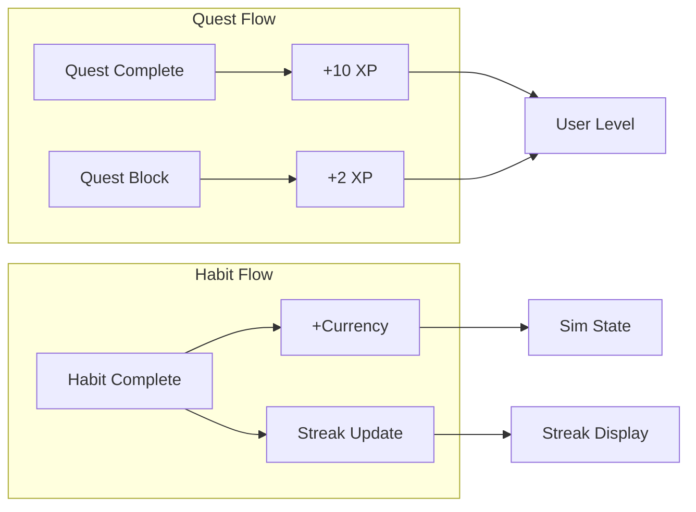

# Gamification Engine

Implementation specification for all gamification logic: XP (quest completion, block action), level system, streak computation, Sim currency, stage progression, and milestone unlocking. All mechanisms are additive—no punishment, no decay.

---

## Overview



---

## XP System

### XP for Quest Completion

| Event | XP | Condition |
|-------|-----|-----------|
| Complete quest | 10 | Base value |
| Complete quest (P0) | 12 | Optional: +2 for critical |
| Complete quest (P1) | 11 | Optional: +1 for high |

**Recommended:** Fixed 10 XP per completion for simplicity. Priority-based bonus is optional.

### XP for Block Action

| Event | XP | Purpose |
|-------|-----|---------|
| Block quest | 2 | Frames blocking as valid queue management, not failure |

### Level System

- **Formula:** `level = floor(total_xp / XP_PER_LEVEL)`
- **XP_PER_LEVEL:** 100 (constant)
- **Level 0:** 0–99 XP
- **Level 1:** 100–199 XP
- **Level 2:** 200–299 XP
- ...

**Storage:** `User.total_xp` (integer, monotonically increasing). Level is derived; optionally cached in `User.level` for performance.

### No Decay

- XP never decreases.
- Level never decreases.
- No punishment for inactivity.

---

## Streak Computation Algorithm

### Inputs

- `habit_id`: The habit
- `user_id`: The user
- `completions`: List of `{habit_id, completed_at}` for this habit (or all HabitCompletion records)
- `user_timezone`: IANA timezone for date boundary

### Outputs

- `current_streak_days`: Consecutive days with at least one completion, ending at the most recent completion
- `longest_streak_days`: All-time best consecutive days
- `last_completed_date`: Most recent date (in user TZ) with a completion

### Step-by-Step

1. **Convert to dates:** For each completion, convert `completed_at` to date in user_timezone. Use `completed_at` in UTC, apply timezone offset to get local date.

2. **Deduplicate:** One completion per calendar day. If multiple completions same day, treat as one.

3. **Sort dates descending:** Most recent first.

4. **Compute current streak:**
   - If no completions: current_streak_days = 0, last_completed_date = null.
   - If completions exist: Start from most recent date. Walk backward, counting consecutive calendar days. Stop when we hit a day with no completion.
   - Example: Completions on 2026-02-26, 25, 24, 22. Streak = 3 (26, 25, 24). Day 23 breaks.

5. **Compute longest streak:**
   - Walk through sorted unique dates. Track longest run of consecutive days seen.
   - Or: On each completion, recompute from that date backward and forward to find max span.

6. **last_completed_date:** Most recent unique date.

### Pseudocode

```
function computeStreak(completions, userTimezone):
    if completions.isEmpty(): return { current: 0, longest: 0, lastDate: null }
    
    dates = unique(set of (completed_at in userTimezone).date for each completion)
    dates = sort(dates, descending)
    
    longest = 0
    currentRun = 0
    prevDate = null
    
    for d in dates:
        if prevDate == null:
            currentRun = 1
        else if prevDate - d == 1 day:
            currentRun += 1
        else:
            longest = max(longest, currentRun)
            currentRun = 1
        prevDate = d
    
    longest = max(longest, currentRun)
    
    currentStreak = 0
    today = now in userTimezone
    if dates[0] == today or dates[0] == today - 1:
        // Most recent is today or yesterday; streak may be active
        currentStreak = 1
        prev = dates[0]
        for i in 1..len(dates):
            if prev - dates[i] == 1: currentStreak += 1; prev = dates[i]
            else: break
    
    return { current: currentStreak, longest: longest, lastDate: dates[0] }
```

### Midnight Boundary

- **Same calendar day:** Completions at 11:59 PM and 12:01 AM on the same calendar day (in user TZ) count as one day.
- **Different days:** 11:59 PM and 12:01 AM on adjacent calendar days count as two days (streak continues if no gap).

### No Punishment

- Missing a day: current_streak_days goes to 0 (or pauses). It does NOT "shrink" previous progress.
- longest_streak_days never decreases.
- Streak freeze (if implemented): Allow user to "freeze" streak for one day; document separately.

---

## Sim Currency Flow

### Trigger

- **Event:** Habit completion (POST /habits/:id/complete)
- **Condition:** First completion of that habit on that calendar day (idempotent per habit per day)

### Flow

1. **Check idempotency:**  
   Exists HabitCompletion for (habit_id, date in user TZ)? If yes, return 200 with no currency change.

2. **Get currency amount:**  
   `currency = habit.currency_per_completion` (default 10)

3. **Atomic update:**
   ```sql
   UPDATE sim_state SET total_currency = total_currency + ?, updated_at = NOW() WHERE user_id = ?
   ```

4. **Recompute stage:**  
   See Stage Thresholds below.

5. **Return:**  
   `currency_earned`, updated Sim state.

### Invariants

- `total_currency` never decreases.
- Only increases on habit completion (first per day per habit).
- Use database transaction; never partial update.

---

## Stage Thresholds

| Stage | Currency Range |
|-------|----------------|
| starter | 0 – 199 |
| stable | 200 – 499 |
| thriving | 500 – 999 |
| flourishing | 1000+ |

### Computation

```
function getStage(totalCurrency):
    if totalCurrency >= 1000: return 'flourishing'
    if totalCurrency >= 500: return 'thriving'
    if totalCurrency >= 200: return 'stable'
    return 'starter'
```

**When to run:** On every SimState.total_currency update. Persist `current_stage` in SimState.

---

## Milestone Unlocking

### Data

- SimMilestone: id, stage, currency_threshold, title, description
- Example: threshold 200, "First apartment"; threshold 500, "Thriving home"

### Logic

- A milestone is **unlocked** when `SimState.total_currency >= SimMilestone.currency_threshold`.
- Computed at read time (GET /sim/milestones) or cached with last currency update.
- Additive: once unlocked, never locked.

### Query

```
SELECT * FROM sim_milestones
WHERE currency_threshold <= (SELECT total_currency FROM sim_state WHERE user_id = ?)
ORDER BY currency_threshold ASC
```

Mark each as `unlocked: true`. Unlocked count = progress narrative.

---

## Idempotency: Habit Completion

### Rule

- **One completion per habit per calendar day** (in user timezone).
- Second completion same day: Return 200. No additional currency. No streak change. No error.

### Implementation

1. Compute `completion_date` = (now in user TZ).date
2. Check: EXISTS HabitCompletion WHERE habit_id = ? AND DATE(completed_at AT TIME ZONE user_tz) = completion_date
3. If exists: Return 200, currency_earned=0, streak unchanged. Do not insert.
4. If not exists: Insert HabitCompletion; add currency; recompute streak; return 200 with currency_earned, streak.

### Unique Constraint

- DB: `UNIQUE(habit_id, completion_date)` where completion_date is stored as date type (in user TZ) or derived consistently.
- Alternative: Store completed_at; use `DATE(completed_at AT TIME ZONE user_timezone)` in uniqueness check. Ensure timezone is from User record.

---

## No-Punishment Invariants

| System | Invariant |
|--------|-----------|
| XP | total_xp never decreases |
| Level | level never decreases |
| Streak | longest_streak_days never decreases; current_streak_days can go to 0 but never negative |
| Sim | total_currency never decreases; current_stage never regresses |
| Milestones | Once unlocked, always unlocked |

---

## Constants Reference

| Constant | Value |
|----------|-------|
| XP_QUEST_COMPLETE | 10 |
| XP_QUEST_BLOCK | 2 |
| XP_PER_LEVEL | 100 |
| CURRENCY_DEFAULT_PER_HABIT | 10 |
| STAGE_STARTER_MAX | 199 |
| STAGE_STABLE_MAX | 499 |
| STAGE_THRIVING_MAX | 999 |
| STAGE_FLOURISHING_MIN | 1000 |

---

## API Integration

### POST /quests/:id/complete

- After updating Quest (status=completed), add User.total_xp += 10 (or 11/12 if priority bonus).
- Return optional `xp_earned: 10` in response.
- (Optional) Return `level`, `total_xp` for UI.

### POST /quests/:id/block

- After creating BlockedQuest, add User.total_xp += 2.
- Return optional `xp_earned: 2`.

### POST /habits/:id/complete

- Idempotency check first.
- If new: Insert HabitCompletion; add currency to SimState; recompute streak; recompute SimState.current_stage.
- Return `currency_earned`, `streak: { current_streak_days, longest_streak_days }`.

### GET /users/me/gamification (Optional)

- Return `total_xp`, `level` for current user.
- Or include in GET /users/me.
