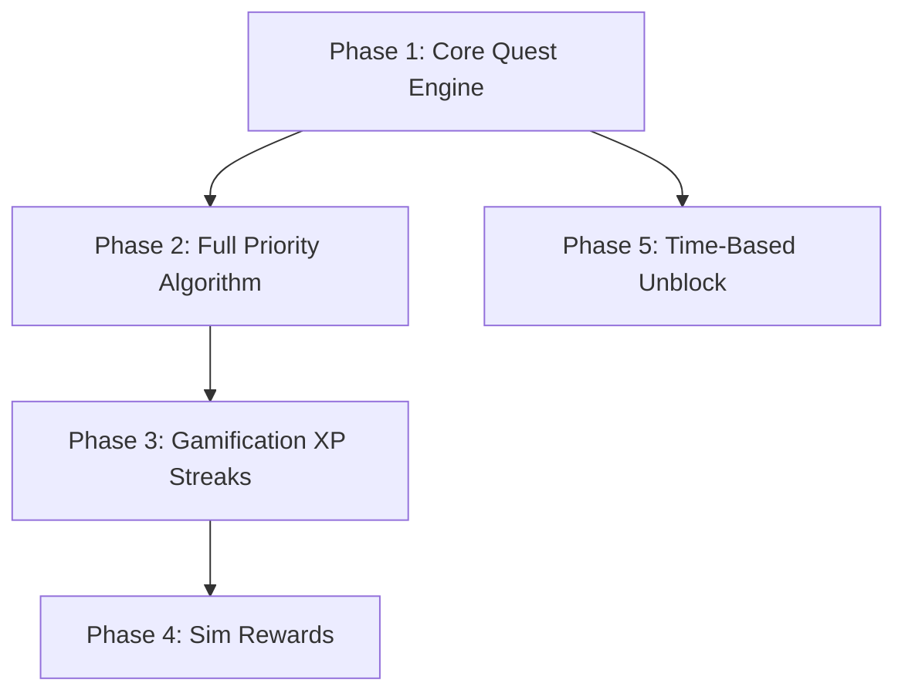

# Backend Implementation Plans

Phased rollout plan for the LifePath backend. Each phase is independently deployable with clear dependencies and milestones.

---

## Phase Overview

---

## Phase 1 — Core Quest Engine (MVP)

**Goal:** Users can create quests, see one current objective, complete or block them. No gamification yet.

### Database

**Tables:**
- `users` (id, email, password_hash, display_name, timezone, created_at, updated_at)
- `quests` (id, user_id, title, notes, priority_level, parent_id, status, time_of_day, context_tag, created_at, updated_at, completed_at)
- `blocked_quests` (id, quest_id, reason, unblock_trigger, unblock_at, unblock_location, created_at, unblocked_at)

**Indexes:**
- quests: (user_id), (user_id, status), (parent_id)
- blocked_quests: (quest_id), (unblock_trigger, unblock_at) WHERE unblocked_at IS NULL

### API Endpoints

- POST /auth/register, POST /auth/login, POST /auth/refresh, POST /auth/logout
- GET /users/me, PATCH /users/me
- GET /quests, GET /quests/current, POST /quests, PATCH /quests/:id
- POST /quests/:id/complete, POST /quests/:id/block, POST /quests/:id/unblock

### Priority Algorithm (Simplified)

- Base scores only: P0=1000, P1=400, P2=200, P3=100, P4=50
- Eligibility: status=pending, not blocked, all ancestors completed
- No modifiers (recency, time-of-day, etc.)
- Tie-break: created_at ASC, id ASC

### Dependency Validation

- On POST/PATCH quest with parent_id: Check for cycles (see [PRIORITY_ALGORITHM.md](PRIORITY_ALGORITHM.md)).
- Reject with 409 if cycle detected.

### Milestones

- [ ] Users table migrated
- [ ] Quests, blocked_quests tables migrated
- [ ] Auth endpoints working
- [ ] Quest CRUD working
- [ ] GET /quests/current returns correct quest (base priority only)
- [ ] Block/unblock working
- [ ] Cycle detection on create/update

---

## Phase 2 — Full Priority Algorithm

**Goal:** Implement all modifiers and penalties. Add optional "Why this quest?" reasons.

### Changes

- Implement full scoring from [PRIORITY_ALGORITHM.md](PRIORITY_ALGORITHM.md):
  - Recency bonus
  - Blocked-return bonus
  - Time-of-day affinity
  - Context match
  - Staleness penalty
- Add `reasons` to GET /quests/current response
- Accept optional `?context=focus|quick|low_energy` on GET /quests/current
- Use User.timezone for time-of-day
- Streak alignment: defer to Phase 3 (requires habits)

### Milestones

- [ ] All modifiers implemented
- [ ] Deterministic tie-breaking verified
- [ ] Unit tests: same input → same output
- [ ] reasons array populated correctly
- [ ] Context query param supported

---

## Phase 3 — Gamification (XP, Streaks)

**Goal:** XP on quest complete/block; levels; habits and streaks.

### Database

**New tables:**
- `habits` (id, user_id, title, currency_per_completion, is_streak_tracked, created_at, updated_at)
- `habit_completions` (id, habit_id, completed_at)
- `streaks` (habit_id, user_id, current_streak_days, longest_streak_days, last_completed_date) — can be derived; caching optional

**User table changes:**
- Add `total_xp` (default 0)
- Optional: Add `level` (cached, derived from total_xp)

**Unique constraint:** habit_completions: UNIQUE(habit_id, completion_date) — use date in user TZ.

### Logic

- On POST /quests/:id/complete: Add 10 to User.total_xp
- On POST /quests/:id/block: Add 2 to User.total_xp
- Implement streak computation from [GAMIFICATION_ENGINE.md](GAMIFICATION_ENGINE.md)
- POST /habits/:id/complete: Idempotent per habit per day; recompute streak
- GET /streaks, GET /streaks/:habitId

### API Endpoints

- GET /habits, POST /habits, PATCH /habits/:id
- POST /habits/:id/complete
- GET /streaks, GET /streaks/:habitId

### Response Additions

- POST /quests/:id/complete: `xp_earned: 10`
- POST /quests/:id/block: `xp_earned: 2`
- GET /users/me: `total_xp`, `level` (or new GET /users/me/gamification)

### Milestones

- [ ] Habits, habit_completions tables migrated
- [ ] User.total_xp added
- [ ] XP on quest complete and block
- [ ] Streak computation correct (unit tests with TZ cases)
- [ ] POST /habits/:id/complete idempotent
- [ ] GET /streaks returns correct data

---

## Phase 4 — Sim Rewards

**Goal:** Sims-style companion; currency from habits; stages and milestones.

### Database

**New tables:**
- `sim_state` (user_id PK, total_currency, current_stage, companion_type, created_at, updated_at)
- `sim_milestones` (id, stage, currency_threshold, title, description)
- Seed sim_milestones with default milestones

**Trigger:** On habit completion (first per day), add currency to sim_state. Recompute current_stage.

### Logic

- Create SimState on user registration (or lazy on first habit completion)
- Stage thresholds: starter [0,199], stable [200,499], thriving [500,999], flourishing [1000+]
- Milestone unlock: total_currency >= threshold
- All from [GAMIFICATION_ENGINE.md](GAMIFICATION_ENGINE.md)

### API Endpoints

- GET /sim/state
- GET /sim/milestones

### Milestones

- [ ] sim_state, sim_milestones tables migrated
- [ ] SimState created for new users (or on first habit)
- [ ] Currency added on habit complete
- [ ] Stage recomputed correctly
- [ ] GET /sim/state, GET /sim/milestones working

---

## Phase 5 — Time-Based Unblock

**Goal:** Automatic unblock when unblock_at is reached.

### Implementation

- Cron job or queue worker (e.g., every 1–5 minutes)
- Query BlockedQuest where unblock_trigger='time' AND unblock_at <= now() AND unblocked_at IS NULL
- For each: set unblocked_at, set Quest.status='pending'
- Use transaction; consider row lock to avoid duplicate processing
- Optional: Push notification on unblock

### Milestones

- [ ] Job implemented
- [ ] Job scheduled
- [ ] Idempotent under concurrent runs
- [ ] (Optional) Location-based unblock interface documented for future

---

## Database Migration Order

1. Phase 1: users, quests, blocked_quests
2. Phase 3: habits, habit_completions; alter users add total_xp
3. Phase 3 (optional): streaks table if cached
4. Phase 4: sim_state, sim_milestones
5. Seed: sim_milestones default rows

---

## API Versioning

- Base path: /api/v1
- Phase 1–5: All under v1
- Breaking changes (e.g., response shape): Introduce /api/v2
- Deprecation: Header X-API-Deprecated with sunset date

---

## Testing Strategy

| Area | Test Type | Focus |
|------|-----------|-------|
| Priority Algorithm | Unit | Determinism; same input → same output |
| Priority Algorithm | Unit | Tie-breaking order |
| Priority Algorithm | Unit | Eligibility (dependency, blocked) |
| Block/Unblock | Integration | State transitions; next_quest |
| Streak | Unit | Timezone; midnight boundary; consecutive days |
| Habit Complete | Integration | Idempotency same day; currency; streak |
| Sim | Integration | Currency add; stage recompute |
| Cycle Detection | Unit | Reject cyclic parent_id |

---

## Rollout Checklist

- [ ] Phase 1 deployed; smoke tests pass
- [ ] Phase 2 deployed; algorithm verified
- [ ] Phase 3 deployed; habits and streaks working
- [ ] Phase 4 deployed; Sim state correct
- [ ] Phase 5 deployed; time-based unblock job running
- [ ] Monitoring: error rate, latency, job success
- [ ] Documentation: OpenAPI, EDGE_CASES updated
